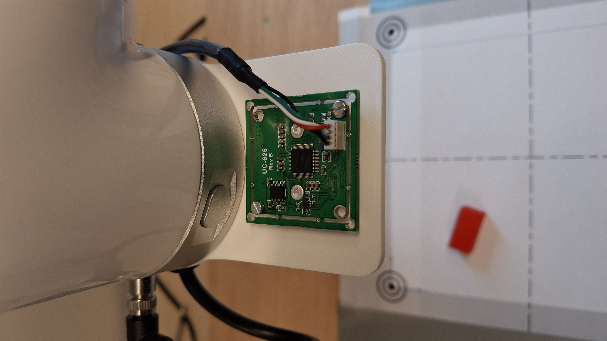
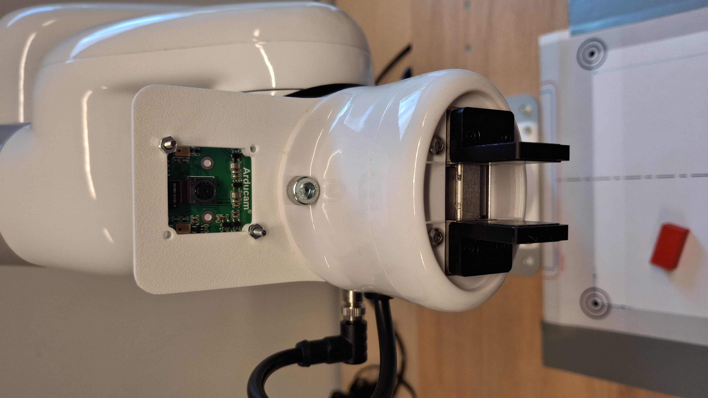
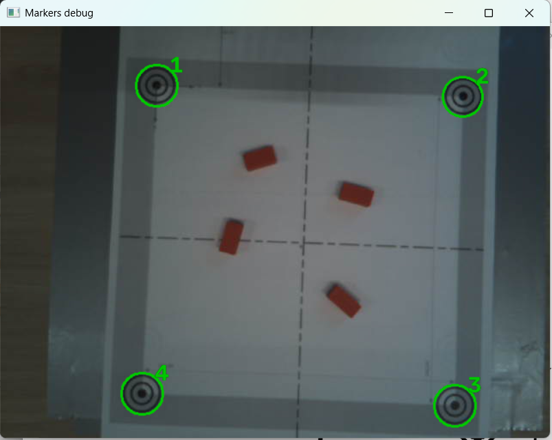
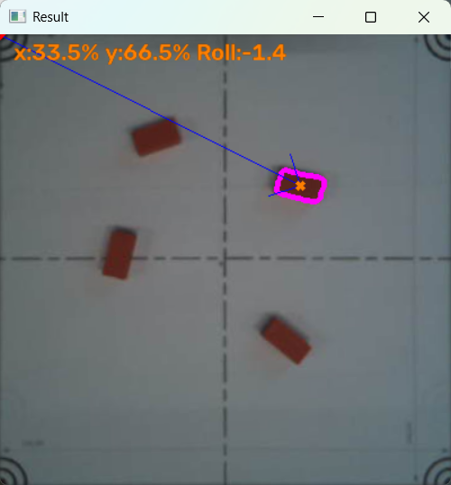
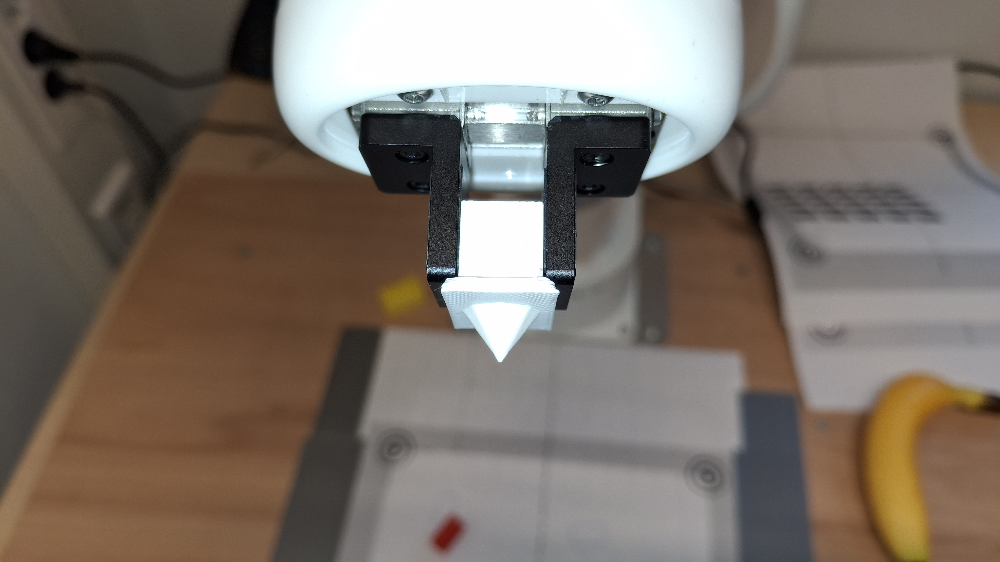
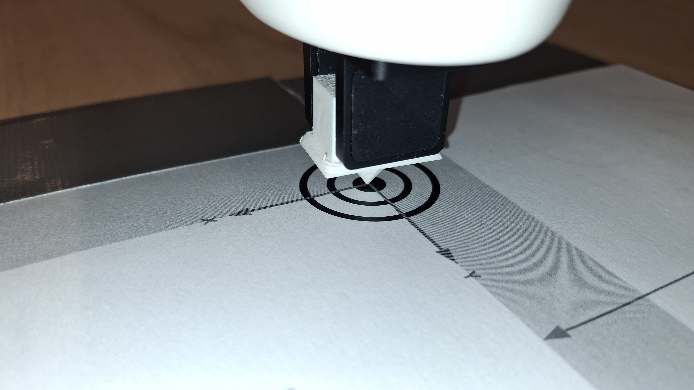
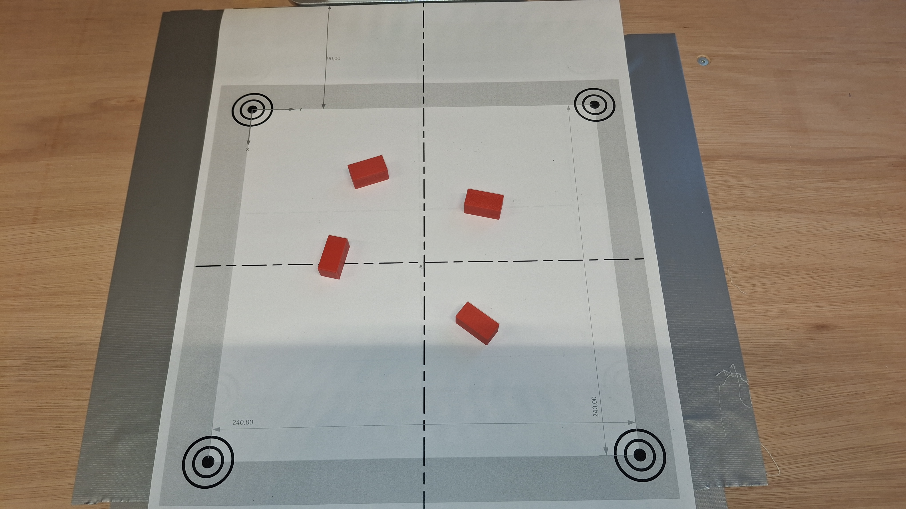
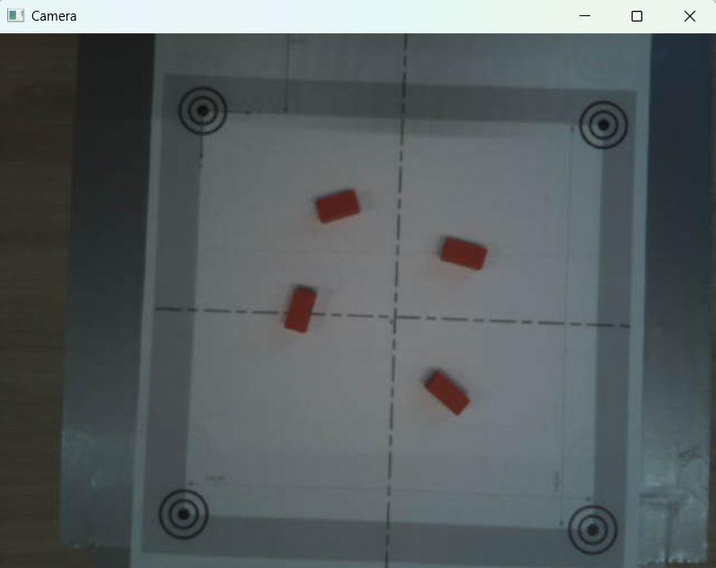
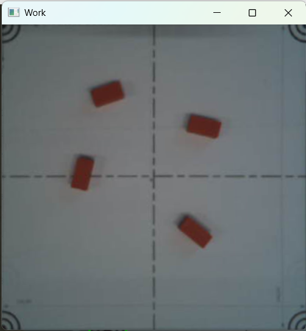

# Opdracht 2: Part picking and placing with vision

In deze opdracht gaan we aan de slag met het oppakken en plaatsen van objecten met behulp van vision. De objecten worden herkend door de camera op basis van kleur en vorm.

## Voorbereidingen
### Montage van de camera
Monteer de camera op de aangegeven positie zoals te zien is in de onderstaande afbeeldingen.
   

   


### Maken van een workspace
Druk het bestand `RobotVisionWorkspaceV2.pdf`(map locatie van het bestand) af met een printer en postioneer de workspace voor de robot..

### Testen van de camera met de workspace
Start het programma `markerTest.py`(map locatie van het bestand)
 en bestudeer de weergegeven afbeeldingen en controleer of alle markers correct worden herkend. Zie onderstaande afbeelding voor een voorbeeld.


Als dit niet correct weergeven wordt verschuif dan de workspace zodat alle markers correct worden herkend.

Fixeer de workspace(met tape) zodat deze niet meer verschuift.

## Objectparameters bepalen
De objectparameters bestaan uit de HSV-kleurwaarden en de vorm van het object.

### Kleurspectra van de op te pakken objecten bepalen
Leg een object op de workspace zodat de camera het kan waarnemen.
Start het tool `hsvFilterFromStream.py`(map locatie van het bestand) en selecteer de juiste kleurwaarden voor elk object.
Bepaal de juiste kleurwaarden voor elk object en noteer deze waarden. 
Je kunt dit doen door de sliders te verplaatsen totdat de alleen het object zichtbaar is en de achtergrond wordt uitgesloten.

:::{tip}
Werk zorgvuldig en kijk goed wat er gebuird bij het verplaatsen van de afzonderlijke sliders.
:::

Noteer deze waarden zorgvuldig, aangezien ze later gebruikt worden voor het herkennen van de objecten.

:::{tip}
Verschuif de objecten over de gehele workspace om te controleren of de kleurwaarden consistent worden herkend.
:::

### Testen van de kleurenspectra's
Start het programma `ObjectDetectorTest.py`(map locatie van het bestand) om te controleren of de objecten correct worden herkend.

Je kunt het type object en de kleur aanpassen in de code om te testen of de objecten correct worden herkend.

  - Zoek de volgend codefragment in `ObjectDetectorTest.py` en pas het aan om het gewenste object en kleur te testen.

```python
detector = ObjectDetector(
    obj_type=ObjectType.ANY,  obj_color=ColorHSV.RED,
    workspace_ratio=1.0,
    ret_image_bool=True,
    )
```

De volgend `obj_type` zijn gedefineerd
```python
class ObjectType:
    SQUARE = 4
    CIRCLE = -1
    ANY = 0
```
De volgende `obj_color` zijn gedefineerd
```python
class ColorHSV:
    """
    MIN HSV, MAX HSV, Invert Hue (bool)
    """
    BLUE = [90, 50, 85], [125, 255, 255], False
    RED = [15, 80, 75], [170, 255, 255], True
    GREEN = [40, 60, 75], [85, 255, 255], False
    ANY = [0, 50, 100], [179, 255, 255], False
```
Je kunt een eigen kleurwaarden gebruiken door een tuple van de vorm `([MIN_H, MIN_S, MIN_V], [MAX_H, MAX_S, MAX_V], Invert_Hue)` te gebruiken. Zie hieronder.

```python
detector = ObjectDetector(
    obj_type=ObjectType.ANY,  obj_color=([15, 80, 75], [170, 255, 255], True),
    workspace_ratio=1.0,
    ret_image_bool=True,
    )
```

In onderstaande afbeelding kun je zien hoe een object wordt herkend op basis van de kleurwaarden die je hebt ingesteld.


De waarden die de object detecor geeft zijn relatief in % t.o.v. mark 1 in de workspace. Mark 1 dient als referentiepunt voor de kalibratie van de workspace. Later worden deze wardes omgerekend naar absolute coördinaten in de workspace (ten opzichte van de robot).

## Kalibratie van de workspace
Om de workspace correct te kalibreren, gebruik je het script `calibrate_workspace.py`. Dit script helpt bij het instellen van de referentiepunten in de workspace zodat de objectdetector de positie van objecten nauwkeurig kan bepalen.

Plaats in de gripper van de robot een kalibratietool, zie afbeelding hieronder.



Voer het script `calibrate_workspace.py` uit om de kalibratie van de workspace te starten. Het script zal je begeleiden bij het instellen van de referentiepunten.
Zorg dat de je nauwkeurig de markers "aanwijst" met de kalibratietool. De kalibratie tool dient loodrecht te worden gehouden tijdens het aanwijzen van de markers, het programma zal aangeven als dit niet correct gebeurt.



Na het succesvol kalibreren van de workspace wordt een json-bestand aangemaakt met de kalibratiegegevens van de workspace. Een voorbeeld van de inhoud van dit bestand is hieronder weergegeven.

```json
{"UpperLeftPose": {"x": 173.642838, "y": -116.241768, "z": 90.18734}, "UpperRightPose": {"x": 172.243362, "y": 128.624191, "z": 88.854294}, "LowerRightPose": {"x": 413.970306, "y": 116.073051, "z": 89.728302}, "LowerLeftPose": {"x": 414.263641, "y": -110.855942, "z": 91.140907}}
```

:::{note}
Als de workspace verschoven is, moet je de kalibratie opnieuw uitvoeren om ervoor te zorgen dat de objectdetector de juiste posities van de objecten kan bepalen.
:::

## Testen van enkelvoudige Pick and Place
Met het script `PickAndPlace.py` kun je de enkelvoudige Pick and Place-functionaliteit van de robot testen. Het script maakt gebruik van de eerder gekalibreerde workspace en de objectdetector om objecten op te pakken en te verplaatsen naar de gewenste locatie.
Het script zal de camera gebruiken om het object te detecteren en vervolgens de robot aansturen om het object op te pakken en naar de opgegeven locatie te verplaatsen. Zorg ervoor dat de objecten correct zijn gepositioneerd binnen de gekalibreerde workspace voordat je het script uitvoert.

  - Zoek de volgend codefragment in `PickAndPlace.py` en pas het aan om het gewenste object en kleur te testen.

```python
detector = ObjectDetector(
    obj_type=ObjectType.ANY,  obj_color=ColorHSV.RED,
    workspace_ratio=1.0,
    ret_image_bool=True,
    )
```

Bestudeer de werking van het script en probeer te begrijpen hoe de objectdetector en de robot samenwerken om de Pick and Place-taken uit te voeren.

## Opdracht 2.1
Maak een programma dat een aantal willekeurige objecten uitsorteert. 
- Kleur: Sorteer de objecten op basis van hun kleur.
- Type: Sorteer de objecten op basis van hun type (bijvoorbeeld blokken, cilinders, enz.).

Het programma moet de objecten detecteren met behulp van de camera en vervolgens de robot aansturen om de objecten naar de juiste locaties te verplaatsen. je kunt hiervoor het script `PickAndPlace.py` als basis gebruiken en aanpassen aan de specifieke eisen van de opdracht.








