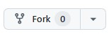
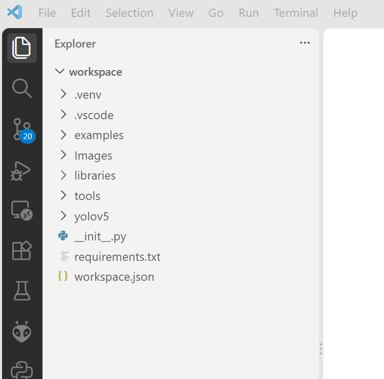
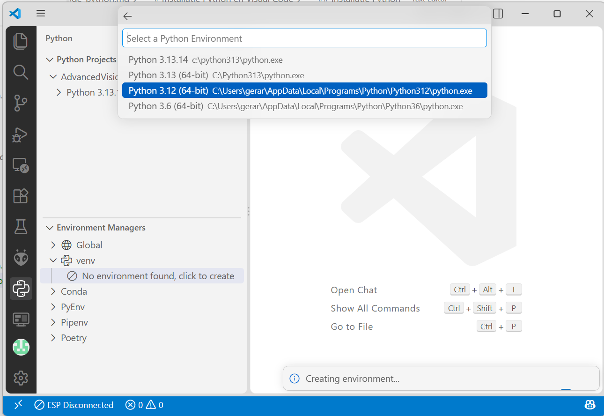

# Installatie van de software

In deze sectie lees je hoe je Visual Studio Code (VS Code) en PlatformIO installeert voor het ontwikkelen van microcontrollerprojecten.

## Installeren van Visual Studio Code

1. Ga naar de officiele website: [https://code.visualstudio.com/](https://code.visualstudio.com/).
2. Download de versie voor jouw besturingssysteem.
3. Volg de installatiestappen op het scherm.

## Installeren van de Python-extensie

1. Open Visual Studio Code.
2. Open Extensions via het zijbalk-icoon of met `Ctrl+Shift+X`.
3. Zoek op `Python`.
4. Klik op `Install`.


## Verkrijgen van de workshopbestanden

Om te starten heb je de workshopbestanden nodig met code, schema's en opdrachtinstructies.

:::::{card}
::::{tab-set}

:::{tab-item} Download ZIP
Download de bestanden als ZIP via:
[Download Workshop Bestanden](https://github.com/AvansMechatronica/UfactoryLite6VisionWorkshop/archive/refs/heads/main.zip)

Pak het ZIP-bestand uit in een map die je makkelijk terugvindt.

:::

:::{tab-item} Git Clone

Als je al bekend bent met Git en github, kun je de bestanden ook via Github verkrijgen. Volg de onderstaande stappen:

* Maak een account aan bij [Github](https://github.com/) en login op dit account

* Open de [UfactoryLite6VisionWorkshop](https://github.com/AvansMechatronica/UfactoryLite6VisionWorkshop) repository

* Maak een Fork van de repository naar je eigen Github account door op het **Fork icoon**  te klikken:



* Volg de instructies, maar wijzig de naam van de nieuwe repository niet. Bevestig met **Create Fork**  

* Nu kun je de workshop clonen naar je lokale machine:

```bash
git clone https://github.com/<jouw_account_naam>/UfactoryLite6VisionWorkshop.git
```

:::

::::

:::::

:::{warning}
Plaats de bestanden niet in een `OneDrive`-map. Dit kan compileerproblemen veroorzaken.
:::

## Python Environment
Een Python-environment (omgeving) is eigenlijk een afzonderlijke “werkruimte” voor Python waarin je je programma’s draait en afhankelijkheden (libraries) installeert.

Visual Code maakt gebruik van virtuele environments:
* Een lokaal, geïsoleerd Python-systeem voor één project.
* Je installeert libraries alleen binnen dat environment.

### Project openen
Start het Visual Code programma en open met het project van deze workshop. 
Doe dit door te navigeren naar `File --> Open Folder` en selecteer de map van de workshopbestanden.

Als je de juiste map hebt geselecteerd zie je alleen de *workspace* map met onderliggende mappen en bestanden, zie afbeelding hieronder.


### Maken van virtuele environment
Open de Python-environment selector in Visual Code om de virtuele omgeving te activeren. Kies voor Python 3.12 als je ook andere versies van Python op je systeem hebt geïnstalleerd.



:::{note}
- Selecteer Python icoontje aan de linkerkant van Visual Code.
- Kies `Custom`
- Bevestig de locatie `.venv`.
- Skip package installation
:::

>Er is nu een map ".venv" in je Project gemaakt

### Installeren van benodigde externe libraries
Open de Visual Code(`Terminal-->New Terminal`) terminal window.


>Controleer of de regel waarop je een commando kunt uitvoeren begint met (.venv). Zo niet sluit Visual Code af en start het programma weer opnieuw.

Je kunt nu de externe libraries installeren met het volgende commando
```bash
pip install -r .\requirements.txt
```

Hierna is de programmeeromgeving gereed voor gebruik. 😃Happy coding !!!

