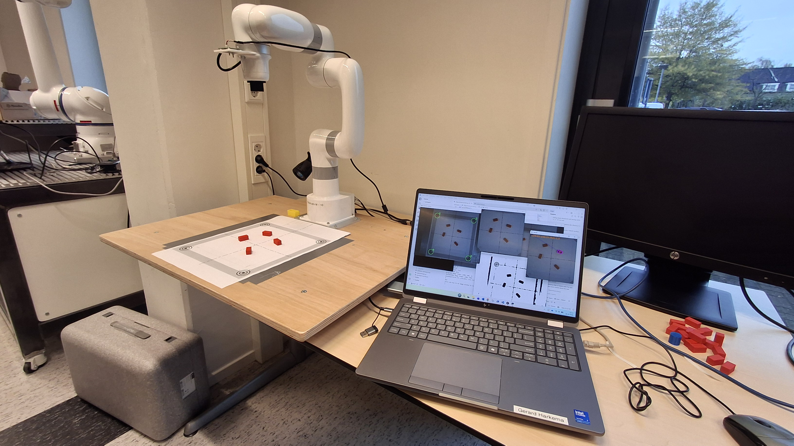
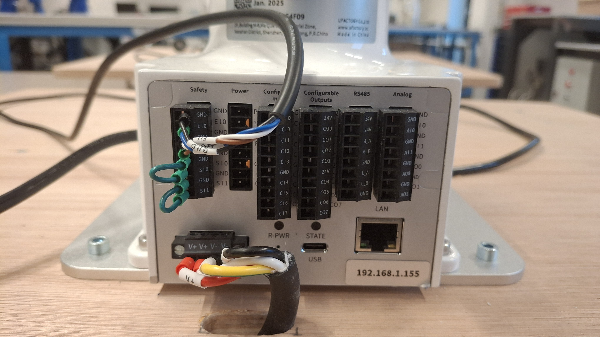
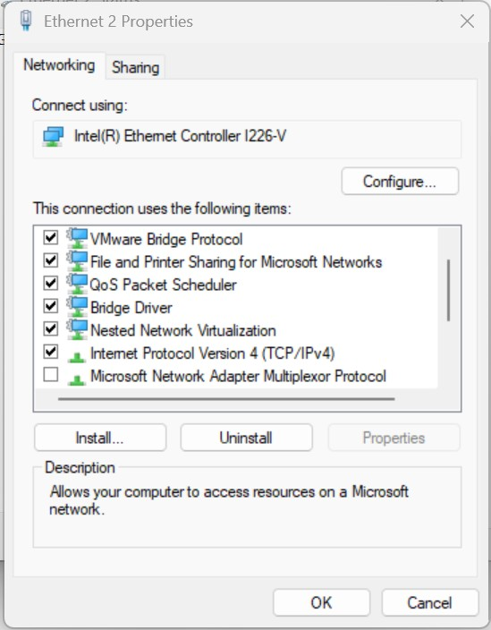
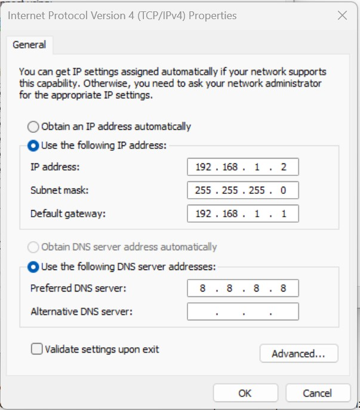

# Aansluiten van de uFactory Lite6 robot op de development-computer

In dit hoofdstuk wordt beschreven hoe je een verbinding kunt opzetten tussen een development-computer en de `uFactory Lite6` robot.

:::{note}
In dit document spreken we over een `development-computer`, hiermee wordt bedoeld de PC of Laptop waarmee je de robot bedient en je programma's voor de robot ontwikkelt.
:::

## Opbouw van de Robotcel
Plaats de robot op de bijgevoegde montageplaat en zorg dat deze stevig is bevestigd.


Verbind de robot met de voeding en zorg dat deze correct is aangesloten. Sluit tevens de noodstop aan.


Noteer het IP-adres van de robot, deze heb je later nodig om verbinding te maken met de robot via je development-computer. Je kunt dit IP-adres vinden op de sticker aan de (rechtsonder)achterzijde van de robot.

## Netwerkverbinding opzetten
:::::::{card} 

::::::{tab-set}

:::::{tab-item} Windows: Rechtstreekse met een `cat5-kabel`

Je kunt een rechtstreekse verbinding opzetten tussen de robot en development-computer door middel van een `cat5-kabel`. Kies deze optie als je geen andere apparaten in het netwerk wilt opnemen.

:::: {attention}
Als je development-computer geen ingebouwde Ethernet poort heeft, kun je een USB naar Ethernet adapter gebruiken.
::::

Je kunt in dit geval het ip-adres van de robot en development-computer handmatig instellen. Zorg ervoor dat je development-computer een ip-adres krijgt in het subnet `192.168.1.x`.

Volg dez stappen voor het instellen van een statisch ip-adres op Windows:

Druk op Win + R, typ ncpa.cpl en druk op Enter.
1. Klik met de rechtermuisknop op je Ethernet adapter en kies Eigenschappen.
2. Selecteer Internet Protocol Version 4 (TCP/IPv4) en klik op Eigenschappen.
3. Kies "Het volgende IP-adres gebruiken":
1. IP-adres: 192.168.1.2
2. Subnetmasker: 255.255.255.0 (dit wordt automatisch ingevuld)
3. Standaardgateway: 192.168.1.1
4. Klik op OK.

De development-computer is nu geconfigureerd met een statisch ip-adres 192.168.1.2 in het subnet `192.168.1.x`.

::::{grid} 2
:::{grid-item-card} 

:::
:::{grid-item-card}

:::
::::

::::{tip}
Soms komt de netwerk verbinding niet tot stand, in dat geval kan het helpen om de netwerkverbindingen uit en weer aan te zetten. Je kunt ook proberen om de robot en development-computer te rebooten.
::::

:::::

:::::{tab-item} Door middel van `router`

Je kunt een verbinding opzetten tussen de robot en development-computer door middel van een router. De router zorgt voor een stabiele verbinding tussen de robot en development-computer, en voorkomt interferentie met andere apparaten in het netwerk. Tevens kun je met een router ook andere apparaten in het netwerk opnemen zoals b.v. camera's of de teachbot

## Configuratie router
De router dient geconfigureerd te worden zodat het subnet `192.168.1.0` wordt. 
>Het instellen van de router valt buiten deze beschrijving en is router-type afhankelijk.

:::{tip}
Gebruik alleen de `LAN` poorten van de router, niet de `WAN` poort.
:::

:::::

::::::

:::::::


#### Robot besturen met je internet browser
Je kunt met je internetbrowser(Chrome/Firefox/Edge) naar een webpagina van de uFactory robot gaan en in de adresbalk het volgende web-pagina intypen
```
<robot-ip>:18333
```
:::{note}
Op de achterzijde van de uFactory Lite robot bevindt zich een sticker met daarop het serienummer van de robot. Op deze sticker staat ook het IP-adres van de robot vermeld.
:::


